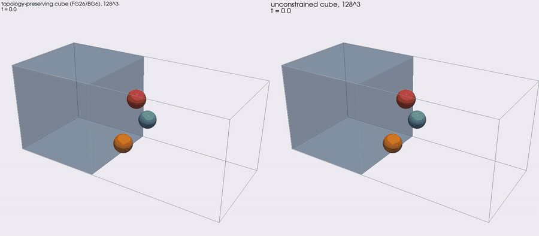
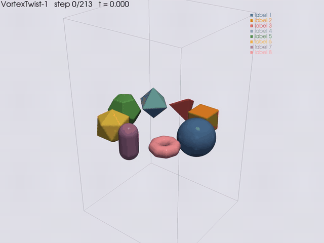

# mogac-openvdb

**Multi-Object Geodesic Active Contours (MOGAC) for [OpenVDB](https://github.com/AcademySoftwareFoundation/openvdb).**

A header-only library that evolves any number of objects that touch, push against and wrap around one another in a single sparse grid pair, and recovers a second-order signed distance field and a closed manifold mesh for each object at any time. It implements B. C. Lucas, M. Kazhdan, R. H. Taylor, *Multi-Object Geodesic Active Contours (MOGAC): How to Represent and Manipulate Multiple Level Sets with only a Label Mask and Distance Field*, MICCAI 2012, together with topology-constrained multi-label contouring.

OpenVDB itself is not modified: it is a git submodule ([`external/openvdb`](external/openvdb)) pinned to an upstream commit, and MOGAC is built on top of it.

## Demo

**Topology preservation with moving obstacles.** A cube is advected through three spheres that orbit as rigid kinematic labels, shown to t = 54. On the left, the cube is protected (26/6 digital topology): it wraps thin sheets around the spheres and stays a single solid with no tunnels or cavities. On the right, the same run without protection lets the spheres punch through; its topology changes from t = 46 on.



([mp4](docs/media/mogac_topology_cube_t54.mp4))

**Eight objects in a vortex.** Eight differently shaped objects (sphere, cube, platonic solids, capsule, torus) start on a ring and spiral in towards the axis in a divergence-free vortex field, stretching along it. As the gaps between them close below a voxel they come into contact, and the label partition keeps them from overlapping or leaving vacuum between them (`VortexEightObjects`).



([mp4](docs/media/mogac_vortex.mp4))

## Quick start

```bash
git clone --recursive https://github.com/rgb2hsv/mogac-openvdb.git
cd mogac-openvdb
cmake -S . -B build
cmake --build build -j
ctest --test-dir build -j
```

If you cloned without `--recursive`, run `git submodule update --init --recursive` first.

### Requirements

- CMake 3.24 or later and a C++17 compiler
- OpenVDB's core dependencies: TBB, zlib, zstd (and Blosc if `MOGAC_OPENVDB_USE_BLOSC=ON`)
- GoogleTest, for the tests

### How OpenVDB is built

OpenVDB's CMake files assume OpenVDB is the top-level project, so it is not pulled in with `add_subdirectory()`. Instead, the first `cmake` configure builds the core library from the submodule and installs it into `build/openvdb-install`, then finds it with `find_package(OpenVDB)`. This takes a few minutes the first time and is repeated only when the submodule commit or the OpenVDB options change.

| Option | Default | Meaning |
|---|---|---|
| `MOGAC_USE_SYSTEM_OPENVDB` | `OFF` | Use an installed OpenVDB (`find_package(OpenVDB)`, e.g. with `CMAKE_PREFIX_PATH`) instead of the submodule |
| `MOGAC_OPENVDB_USE_BLOSC` | `OFF` | Build the submodule with Blosc compression |
| `MOGAC_OPENVDB_CMAKE_ARGS` | empty | Extra CMake arguments for the submodule build (a `;`-list) |
| `MOGAC_BUILD_TESTS` | `ON` | Build `mogac_test` |

To move to a newer OpenVDB:

```bash
git -C external/openvdb fetch origin && git -C external/openvdb checkout <commit-or-tag>
```

then commit the updated submodule.

### Using it from another project

The library is the `MOGAC::mogac` interface target (include directory plus `OpenVDB::openvdb`):

```cmake
add_subdirectory(mogac-openvdb)          # or set MOGAC_USE_SYSTEM_OPENVDB=ON
target_link_libraries(my_app PRIVATE MOGAC::mogac)
```

```cpp
#include <mogac/LevelSetMultiObject.h>      // MultiLevelSet, LevelSetMultiObject, ...
#include <mogac/LevelSetMultiObjectMesh.h>  // multiObjectToMesh
```

The classes keep the `openvdb::tools` namespace they were written for, so code is source compatible with the version of this tool proposed upstream ([AcademySoftwareFoundation/openvdb#2431](https://github.com/AcademySoftwareFoundation/openvdb/pull/2431)).

## Repository layout

| Path | Contents |
|---|---|
| [`include/mogac/LevelSetMultiObject.h`](include/mogac/LevelSetMultiObject.h) | `MultiLevelSet`, `MultiLevelSetRedistance`, `LabelAwareStencil`, `MultiObjectForces`, the evolver `LevelSetMultiObject` |
| [`include/mogac/LevelSetMultiObjectMesh.h`](include/mogac/LevelSetMultiObjectMesh.h) | Topology-constrained multi-label contouring `multiObjectToMesh` |
| [`tests/`](tests) | GoogleTest suites, scene fixtures, topology checks and the opt-in per-step frame dump |
| [`scripts/render_mogac_tests.py`](scripts/render_mogac_tests.py) | Runs the test simulations and renders every one to PNG frames, an MP4 and key-frame PLY meshes |
| [`docs/CHANGES.txt`](docs/CHANGES.txt) | Feature summary (written as OpenVDB pending-changes notes) |
| [`docs/media/`](docs/media) | Demo videos |
| [`external/openvdb`](external/openvdb) | OpenVDB, as a git submodule |

## Example

```cpp
#include <mogac/LevelSetMultiObject.h>
#include <mogac/LevelSetMultiObjectMesh.h>
using namespace openvdb;

// signed distance grids (GRID_LEVEL_SET), one per non-zero label
std::map<int32_t, FloatGrid::ConstPtr> grids = { {1, sphereA}, {2, sphereB} };
auto mls = tools::MultiLevelSet<>::fromSignedGrids(grids);

// speed: advection by a velocity grid plus mean curvature smoothing
using MLS = tools::MultiLevelSet<>;
tools::MultiObjectForces<MLS> forces;
forces.setAdvection(velocityGrid, 1.0f);
forces.setCurvatureWeight(0.01f);

// evolve from t = 0 to t = 10
tools::LevelSetMultiObject<MLS, tools::MultiObjectForces<MLS>> evolver(*mls, forces);
// optional: keep these labels' digital topology (see MultiObjectConnectivity)
// evolver.setTopologyPreservingLabels({1, 2});
evolver.advect(0.0, 10.0);

// a regular signed distance grid for one label ...
FloatGrid::Ptr psi1 = mls->extractSignedDistance(1);
// ... or closed manifold meshes for all labels at once
std::map<int32_t, tools::LabelMesh> meshes = tools::multiObjectToMesh(*mls);

// labels are 16-bit by default; register that grid type before file I/O
tools::registerMultiLevelSetGridTypes();
io::File("pair.vdb").write({mls->phi(), mls->labels()});
```

## Why this representation

The usual way to evolve N objects is N signed distance level sets plus coupling terms to stop them overlapping or leaving vacuum between them. MOGAC stores instead **one unsigned distance grid `phi` and one integer label grid** over a single shared narrow band:

- **Memory and work independent of the object count.** One float and one 16-bit label per band voxel, whether there are 2 objects or 30,000. N level sets cost N bands and N updates per step.
- **A partition by construction.** Each voxel has exactly one label, so objects can never overlap and no gaps open between touching objects. No penalty or coupling terms, and no post-hoc conflict resolution.
- **Every object is still a level set.** Near its boundary, the signed distance of label `l` is `psi_l = -phi` inside and `+phi` outside, so per-object curvature, normals and speeds are available as for a single level set. `extractSignedDistance(l)` returns a regular OpenVDB level set grid.
- **Contacts, junctions and topology are local label tests.** Triple junctions, contact handling and digital topology checks become neighborhood queries on the label grid.
- **Labels are cheap to add, remove, freeze or drive.** Objects can appear, vanish, be held fixed (walls), stay passive (background label 0) or follow prescribed rigid motion, without reallocating grids.

## Algorithm (high level)

Each step of `LevelSetMultiObject`:

1. **Speeds.** For each band voxel, the speed functor is evaluated for its own label and its face neighbors' labels (all 26 neighbors at full-voxel motion), on the reconstructed per-label signed distances (`LabelAwareStencil`). The built-in `MultiObjectForces` combines advection, mean curvature and pressure terms.
2. **Update and projection.** Every candidate label's `psi` is advanced. Each voxel then takes the label with the smallest value, and `phi` becomes half the gap between the two smallest values (the MOGAC two-smallest projection). The passive background label 0 is the complement; fixed labels act as walls.
3. **Topology (optional).** Label changes that touch protected labels are applied only if the voxel is a simple point (Bertrand–Malandain topological numbers for the chosen connectivity pair).
4. **Redistancing.** `phi` is restored to an unsigned distance: second-order Russo–Smereka seeding at the interfaces, then Jacobi Godunov iterations to a tolerance.
5. **Band maintenance.** The band is grown and pruned to the requested half width.

## How it was adapted to OpenVDB

- **Sparse paired trees.** `MultiLevelSet` holds a `FloatGrid` (`phi`) and a label grid of the same topology. Labels default to a new `Int16LabelTree`/`Int16LabelGrid`; `registerMultiLevelSetGridTypes()` enables file I/O, and other integer label trees are supported. The factories `fromSignedGrids()` and `fromLabelGrid()` build the pair from ordinary level sets or a label volume, and `validate()` checks the invariants.
- **Leaf-parallel TBB updates** via `LeafManager` and auxiliary leaf buffers, with results independent of the grain size and thread count (asserted by tests).
- **OpenVDB numerics reused.** `math::BiasedGradientScheme` (HJWENO5 by default, FIRST_BIAS for half width 2), `math::TemporalIntegrationScheme` (TVD-RK2 by default, with projection after each stage), velocity and scalar fields given as ordinary grids, `util::NullInterrupter`-style interrupters, and the usual `GRID_LEVEL_SET` conventions for extraction.
- **Standard OpenVDB outputs.** Per-label signed distance grids, and `multiObjectToMesh()` meshes (points, CCW triangles, optional normals) for each label.

## Features and options

| Area | API |
|---|---|
| Holder | `MultiLevelSet::fromSignedGrids`, `fromLabelGrid`, `extractSignedDistance` (`ExtractSettings`), `labelSet`, `dilate`/`erode`, `validate`, `MultiLevelSetRedistance` |
| Schemes | `setSpatialScheme` (HJWENO5 / FIRST_BIAS), `setTemporalScheme` (TVD-RK1/2), `setCFL` |
| Forces | `MultiObjectForces`: curvature, advection, pressure, per-label advection (`setAdvection(label, field, weight)`), fixed and inactive labels, speed extension (`setSpeedExtension`) |
| Operator splitting | `setSplitting`: Strang splitting of hyperbolic and parabolic terms, used only when curvature would limit the step; interruptible sub-updates |
| Interface motion | `setMaxInterfaceMotion(0.5 \| 1.0)`: half-voxel (default) or full-voxel motion per step |
| Kinematic labels | `setKinematicLabel(label, sdf, motion(t))`, `clearKinematicLabel`: rigid obstacles with prescribed motion |
| Topology | `setTopologyPreservingLabels`, `setConnectivity` (FG26/BG6, FG6/BG26, FG18/BG6, FG6/BG18), `setMinimumPhi`, `phiFloor`, `validateTopologyFloor` |
| Volume | `setVolumeConstraint`, `preserveInitialVolume`, `setVolumeRelaxation`, `clearVolumeConstraints`, `labelVolume` |
| Redistancing | incremental by default, `setFullRedistance(true)` for exact full solves, `markExternallyModified()` after external edits |
| Diagnostics | `scratchMemUsage`, `redistanceIterations`, `redistanceCapHits`, `eulerFallbacks` |
| Meshing | `multiObjectToMesh` (`MultiObjectMeshSettings`: connectivity, junction correction, closest-point junctions, normals, `minimumPhi`, grain size) |

## Accuracy refinements

- **Second-order signed distance reconstruction** with Russo–Smereka subcell seeding.
- **Closest-point reconstruction at triple junctions** (on by default; `ExtractSettings::closestPointJunctions`). At junctions, `phi` may be the distance to a third object; local planar reconstructions of the label's boundary give `psi` there, with a Godunov fallback.
- **Speed extension.** Advection and pressure are sampled at the closest interface point, so the band keeps a distance function under strongly varying fields.
- **Per-label volume constraints.** A Lagrange-multiplier speed cancels the volume change caused by the other forces, plus a relaxation term toward the target.
- **Topology-preserving evolution** keeps a `phi` floor on protected interfaces, so the digital topology is never ambiguous at near-zero `phi`.
- **Topology-consistent meshing.** Classification is by label, never by the sign of `phi`, using case tables for each connectivity pair, so each mesh's topology matches the label's digital region.

## Optimizations

- **Incremental redistancing.** Each step re-solves only the band region its own changes can reach; it matches a full solve to within 1e-4·dx for half width ≤ 3. The Jacobi solve stops at a tolerance rather than after a fixed iteration count.
- **Adaptive operator splitting.** Steps are split only when the parabolic stability limit is below the hyperbolic step; unsplit steps evaluate the speeds once.
- **Direct field reads.** Velocity and pressure grids whose transform matches the level set are read voxel-by-voxel instead of interpolated, with identical results.
- **Pooled per-leaf scratch** (candidate lists, masks) reused across steps, and auxiliary leaf buffers instead of grid copies; `scratchMemUsage()` reports the peak.
- **16-bit labels by default**, halving the label grid.
- **Hashed containers** (`std::unordered_map`/`unordered_set` with a `Coord` hash) on per-voxel hot paths, with all order-dependent work kept deterministic.
- **27 colored passes** apply topology-checked label changes in parallel without conflicts.
- **Block-based mesher.** It reads labels once per leaf block with a one-voxel halo and skips cells whose eight labels agree, so work scales with the number of interface leaves.

## Tests

`mogac_test` holds the full test set: 96 tests in `TestLevelSetMultiObject` and `TestLevelSetMultiObjectMesh`. Besides every public entry point (holder invariants, factories and their error cases, extraction, dilate/erode, redistancing, 16-bit labels and grid I/O, stencil and forces, evolver options, mesher case tables and geometry), it runs the long scenarios: contact without cascading, growth, advection, curvature flow, fixed walls, kinematic obstacles, partition invariance under random speeds, the eight-object vortex, and the topology-preserving cube through orbiting spheres under several connectivity rules against an unprotected control, many of them at both half- and full-voxel motion.

```bash
ctest --test-dir build -j16                                  # all tests, ~4.5 min on 16 cores
./build/tests/mogac_test --gtest_filter='*VortexEightObjects*'  # one test
```

Environment variables:

| Variable | Effect |
|---|---|
| `OPENVDB_MOGAC_FRAME_DIR=<dir>` | Every evolver writes one PLY of all label meshes per step to `<dir>/<TestName>-<k>/` (see [`tests/LevelSetMultiObjectFrames.h`](tests/LevelSetMultiObjectFrames.h)) |
| `OPENVDB_MOGAC_DEBUG_DIR=<dir>` | Topology verifications dump their grids and meshes there (on failure they always dump, to a temp directory by default) |
| `OPENVDB_MOGAC_CHECK_HASHES=1` | Compare long runs against committed result hashes (`LSMO_RECORD_HASHES=1` prints new ones) |
| `OPENVDB_MOGAC_BENCHMARK=1` | Run the informational benchmark |
| `OPENVDB_MOGAC_VERBOSE=1` | Extra mesher test output |

## Rendering the simulations

[`scripts/render_mogac_tests.py`](scripts/render_mogac_tests.py) builds `mogac_test`, runs it in parallel shards with `OPENVDB_MOGAC_FRAME_DIR` set, and renders every simulation with a fixed camera and one color per label:

```
<out>/<sim>/png/frame_%05d.png   one image per step
<out>/<sim>/<sim>.mp4            the frames as an H.264 video
<out>/<sim>/meshes/{initial,midway,final}.ply and key_frames.txt
```

It needs `numpy` and `pyvista` (`pip install numpy pyvista`) and `ffmpeg`:

```bash
python3 scripts/render_mogac_tests.py --out /path/to/renders --filter '*Vortex*'
```

Run it with `--help` for the remaining options (`--skip-build`, `--skip-tests`, `--skip-render`, `--keep-frames`, `--shards`, `--jobs`, `--fps`).

## Documentation

The Doxygen comments in [`include/mogac/`](include/mogac) are the API reference. [`docs/CHANGES.txt`](docs/CHANGES.txt) summarizes the features.

## References

- B. C. Lucas, M. Kazhdan, R. H. Taylor, "Multi-Object Geodesic Active Contours (MOGAC): How to Represent and Manipulate Multiple Level Sets with only a Label Mask and Distance Field", MICCAI 2012.
- G. Russo, P. Smereka, "A remark on computing distance functions", J. Comput. Phys. 163(1), 2000.
- F. du Chene, C. Min, F. Gibou, "Second-order accurate computation of curvatures in a level set framework using novel high-order reinitialization methods", J. Sci. Comput. 35, 2008.
- D. L. Chopp, "Some improvements of the fast marching method", SIAM J. Sci. Comput. 23(1), 2001.
- G. Bertrand, G. Malandain, "A new characterization of three-dimensional simple points", Pattern Recognition Letters 15(2), 1994.
- J.-O. Lachaud, A. Montanvert, "Continuous analogs of digital boundaries: a topological approach to iso-surfaces", Graphical Models 62(3), 2000.

## License

Apache-2.0, like OpenVDB (see the SPDX headers in each file). Copyright Contributors to the OpenVDB Project.
